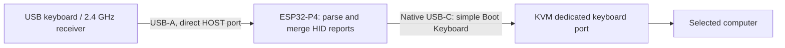

# ESP32-P4 KVM Keyboard Bridge

[English](README.md) | [简体中文](README.zh-CN.md) · MIT licensed

## 1. What this project does

**Use a modern USB keyboard with a KVM's dedicated keyboard port by translating its HID reports on an ESP32-P4.**

The original case was a **NuPhy Air75 V3 2.4 GHz receiver** that could not type through the **TESmart HKS202-M24 dedicated keyboard port**, even though it worked through the KVM's general USB port. With a **Waveshare ESP32-P4-Module-DEV-KIT** between them, normal typing, modifiers, Backspace and key release work. The bridge also recovers after firmware restart without unplugging the KVM cable.



It runs on the P4 itself: **no keyboard firmware modification, C6 firmware, computer helper, Home Assistant or network connection is required**. An optional simultaneous **Ctrl+Alt+/** shortcut can ask the TESmart KVM to select its next input.

**Verified scope:** one Air75 V3 receiver, one HKS202-M24 and the production-rev3 Waveshare board. Other keyboards and KVMs need testing. Media keys, mouse forwarding, RGB/configuration traffic and more than six simultaneous ordinary keys are outside this version's scope. See [compatibility and test evidence](docs/compatibility.md).

Ordinary output usages are limited to `0x04–0x65`; extended keys such as F13–F24 are not forwarded.

### Long-idle recovery update (2026-10-19)

A tester reported an unresponsive keyboard followed by repeated input after a long idle period. The earlier firmware could retain transitions while USB was suspended, and its in-flight flag could outlive a fast bus reset. LED control requests also ran in the forwarding worker and could block it. These are confirmed code gaps; which path caused that past incident was not captured.

Current source discards transitions older than 100 ms, clears old queues on suspend/resume/re-enumeration, sends all-keys-up and waits for a fresh physical release after recovery. Normal acknowledged long presses are preserved. A genuinely stalled active output gets a bounded re-enumeration attempt. LED/close/restart requests now run in a separate serialized control task, and input transfer errors request endpoint restart. Recovery can consume the initial wake-up keystroke; release the keys and press again. This update has not yet passed an overnight idle soak test. See [reliability notes](docs/reliability.md).

**Prebuilt version:** the v0.1.0 binary below predates these recovery changes. Build current source for the fixes; the old binary remains a versioned initial-test artifact.

## 2. How it works

P4 acts as two different USB participants at once:

1. **Host towards the real keyboard.** Read the HID report descriptor, decode key arrays or NKRO bitmaps, handle Report IDs and merge keyboard interfaces into a common pressed-key state.
2. **Device towards the KVM.** Enumerate as one HID Boot Keyboard interface and emit an **8-byte report: modifier byte, reserved byte, six key usages**. The output has **no Report ID**.

The KVM sees the bridge's new USB device, not the original keyboard's composite descriptors. This is report translation and device re-enumeration; changing a USB version number alone would not do the job.

| Output property | Value |
| --- | --- |
| USB descriptor version | `bcdUSB = 0x0110` (USB 1.10) |
| Electrical speed | Full Speed, 12 Mbit/s |
| HID descriptor version | HID 1.11, separate from the USB version |
| Interface | One HID Boot Keyboard, subclass 1 / protocol 1 |
| Input report | 8 bytes, 6 ordinary keys plus modifier bits, no Report ID |
| Interrupt IN endpoint | `0x81`, 8 bytes, 1 ms interval |
| More than six ordinary keys | Standard `ErrorRollOver`; normal state resumes on release |

**Is NKRO the proven root cause? No.** The tested NuPhy receiver exposes both a conventional 8-byte keyboard interface and a 19-byte bitmap interface. This bridge changes several things together: interface structure, report shape, IDs and device presentation. The successful result proves that this simpler presentation works; it does not isolate the KVM's exact parser limitation or identify its controller chip. USB 1.1 is not another name for 6KRO.

For the optional hotkey, you still press **Ctrl+Alt+/** together. P4 consumes the completed chord, releases the old host's held keys, then sends **RightCtrl → release → RightCtrl → release → PageDown → release**. This uses the KVM's native next-input command, so there is no cached active-PC state to get out of sync. The KVM must have its default RightCtrl hotkey trigger enabled. Partial key states before the chord is complete can already reach the host; P4 sends all-keys-up before the macro.

## 3. Implementation and reproduction

### Hardware and wiring

Tested board: **Waveshare ESP32-P4-Module-DEV-KIT, production silicon rev3.2, 16 MB flash**. The C6 is unused. This configuration is not a generic binary for all P4 boards or engineering samples.

| Connection | Purpose |
| --- | --- |
| Keyboard / receiver → board's **direct USB-A port**, jumper **HOST** | HS-capable host controller reads the keyboard; the keyboard negotiates its own speed |
| Board's **native USB-C, not UART/CH343** → KVM dedicated keyboard port | Full-Speed keyboard output, GPIO24 D− / GPIO25 D+ |
| Board's **UART / CH343 USB-C** → computer / power | Flashing, power and UART0 diagnostics at 115200 baud |

Use USB data cables. Keep the UART/CH343 cable connected for the tested power arrangement. Identify the direct USB-A port using the [board documentation](https://docs.waveshare.net/ESP32-P4-Module-DEV-KIT/): this firmware disables hub support and bypasses the onboard CH334 hub. The other USB-A sockets are not interchangeable in this configuration. Ethernet and KVM UART/IR wiring are unnecessary for this standalone project.

### Build and flash

Tested stack: **ESPHome 2026.5.3 / ESP-IDF 5.5.4**, `esp_tinyusb 2.1.1`, `usb_host_hid 1.1.0`. These versions are pinned; the generated dependency snapshot is in [firmware/dependencies.lock](firmware/dependencies.lock).

```sh
git clone https://github.com/yufeiran/esp32-p4-kvm-keyboard-bridge.git
cd esp32-p4-kvm-keyboard-bridge
python -m venv .venv
# Activate the environment (Windows: .venv\Scripts\activate).
# Linux/macOS: source .venv/bin/activate
python -m pip install -r requirements.txt
python -m esphome compile keyboard-bridge.yaml
# Create a SEPARATE flashing environment; do not upgrade ESPHome's pinned esptool.
python -m venv .flash-venv
# Windows:
.flash-venv\Scripts\python -m pip install -r requirements-flash.txt
.flash-venv\Scripts\python -m esptool --chip esp32p4 --port COM4 --baud 460800 write-flash 0x0 .esphome/build/p4-keyboard-bridge/.pioenvs/p4-keyboard-bridge/firmware.factory.bin
# Linux/macOS: use .flash-venv/bin/python and your serial port instead.
python -m esphome logs keyboard-bridge.yaml --device COM4
```

Replace `COM4` with your CH343 serial port, such as `/dev/ttyUSB0` on Linux. On Windows, clone into a short path such as `E:\Projects\p4-keyboard-bridge` to avoid SDK path-length problems. The baseline config is offline and has no OTA endpoint; updates use the CH343 port. Build artifacts are under `.esphome/build/p4-keyboard-bridge/.pioenvs/p4-keyboard-bridge/`.

**Serial tool version:** ESPHome 2026.5.3 pins esptool 5.2.0, which is not the tested flasher for this production-rev3 P4. The separate flashing environment above uses **esptool 5.4.0**, the version actually used for the hardware tests. Keep these environments separate.

For the exact tested board, a prebuilt offline image is available in [firmware](firmware) and [Releases](https://github.com/yufeiran/esp32-p4-kvm-keyboard-bridge/releases). Verify its SHA-256 against `firmware/manifest.json`, then use the same esptool command with `firmware/p4-keyboard-bridge-rev3.factory.bin` as the file. It is a merged factory image flashed at **0x0**, not an application-only image. Hotkey is disabled in that binary; rebuild to enable it. Close serial log monitors before flashing.

To enable the optional TESmart shortcut, change this setting and rebuild:

```yaml
kvm_usb_bridge:
  id: keyboard_bridge
  switch_hotkey: true
```

Either left/right Ctrl and Alt are accepted; all six arrival orders of the three keys are handled. Shift/GUI-modified variants are excluded. One hold triggers once, a short debounce prevents repeats, and a canceled macro is never replayed after reconnection. On macOS the physical Alt key is usually labeled Option; the firmware matches HID usages, not OS characters. Slash means the standard slash key (usage `0x38`), not keypad divide.

### Code map

| File | Responsibility |
| --- | --- |
| [keyboard-bridge.yaml](keyboard-bridge.yaml) | Minimal offline firmware configuration |
| [hid_keyboard.h](components/kvm_usb_bridge/hid_keyboard.h) | Portable HID parser, state merge, 6KRO output and LED encoding |
| [kvm_usb_bridge.cpp](components/kvm_usb_bridge/kvm_usb_bridge.cpp) | IDF host, TinyUSB device, queues, reconnect and PHY routing |
| [switch_hotkey.h](components/kvm_usb_bridge/switch_hotkey.h) | Optional chord filter and acknowledged KVM macro |
| [report_buffer.h](components/kvm_usb_bridge/report_buffer.h) | Timestamped bounded output queue and fresh-release gate |
| [__init__.py](components/kvm_usb_bridge/__init__.py) | ESPHome configuration and IDF dependencies |
| [tests](tests) | Real NuPhy descriptor fixtures, parser/macro tests and linked-ELF USB audit |

The board-specific restart fix matters: native GPIO24/25 initially belong to USB Serial/JTAG, while Full-Speed OTG normally uses GPIO26/27. The firmware temporarily disables the native PHY's pull-up **and** pads, initializes TinyUSB, switches the PHY route at runtime and reconnects. Merely soft-disconnecting OTG left this KVM holding stale USB state during testing. **No eFuses are changed.** Details: [architecture](docs/architecture.md).

### Tests

Portable tests run without hardware:

```sh
cmake -S . -B build
cmake --build build
ctest --test-dir build --output-on-failure
```

Windows with MSVC Build Tools can alternatively run `powershell -ExecutionPolicy Bypass -File tests/run_tests.ps1`.

After building the firmware, audit its **actual linked descriptors**:

```sh
python tests/verify_firmware.py .esphome/build/p4-keyboard-bridge/.pioenvs/p4-keyboard-bridge/firmware.elf --bin .esphome/build/p4-keyboard-bridge/.pioenvs/p4-keyboard-bridge/firmware.bin
```

Tests cover 6KRO/NKRO, real Air75 V3 descriptors, modifiers, Report IDs, LEDs, unplug release, malformed data, 10,000 randomized descriptors, all chord arrival orders, timing, acknowledged macro delivery and abort/debounce behavior. Compilation and unit tests cannot establish compatibility with an untested physical keyboard/KVM. Share results using the compatibility issue template.

### References and attribution

- [USB-IF HID 1.11 specification](https://www.usb.org/sites/default/files/hid1_11.pdf), especially Appendix B's Boot Keyboard report format.
- [Espressif ESP-IDF 5.5.4 USB Host](https://docs.espressif.com/projects/esp-idf/en/v5.5.4/esp32p4/api-reference/peripherals/usb_host.html) and [USB Device](https://docs.espressif.com/projects/esp-usb/en/latest/esp32p4/usb_device.html).
- [Waveshare board documentation](https://docs.waveshare.net/ESP32-P4-Module-DEV-KIT/).
- TESmart HKS202-M24 user manual: next-input shortcut, printed page 25 / PDF page 30. The vendor manual is not redistributed here.
- [ESP32KeyBridge](https://github.com/tanakamasayuki/ESP32KeyBridge) inspired the dual-controller architecture; this implementation uses IDF HID Host and an ESPHome external component. That project's code is not bundled.

The bridge uses prototype USB identifiers `303A:4004` inherited from the ESP32 experiment; this is not an allocation of a VID/PID to this project. Dependencies retain their own licenses. This project is an independent compatibility experiment, with no affiliation to TESmart, NuPhy, Waveshare or Espressif.

[AI / automation entry point](llms.txt) · [Compatibility evidence](docs/compatibility.md) · [Short explanation to share](docs/share.md)
