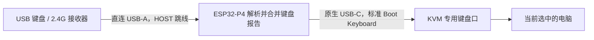

# ESP32-P4 KVM 键盘兼容桥接

[English](README.md) | [简体中文](README.zh-CN.md) · MIT 开源

## 1. 做成了什么

**在键盘与 KVM 之间加入一块 ESP32-P4，让原本不兼容的键盘能够使用 KVM 的专用键盘口**。

起因是 **NuPhy Air75 V3 的 2.4 GHz 接收器**插入 **TESmart HKS202-M24 专用键盘口**后完全不能打字，但接入 KVM 普通 USB 口可以使用。加入 **微雪 ESP32-P4-Module-DEV-KIT** 后，专用口可以正常打字、使用修饰键和退格，松键正常；固件重启后也能自动恢复，不必重新插拔 KVM 线。



**不用修改键盘固件，不需要 C6、电脑常驻程序、Home Assistant 或网络连接**。另外可以选择启用 **同时按 Ctrl+Alt+/**，让 P4 请求 TESmart 切换到下一个输入。

**验证范围**：一把 Air75 V3 的接收器、一台 HKS202-M24，以及量产 rev3 微雪开发板。其他键盘、KVM 需要实测。当前不转发多媒体键、鼠标、RGB/厂商配置流量，输出最多六个普通按键加修饰键。完整记录见[兼容性与测试证据](docs/compatibility.md)。

普通输出键码范围为 `0x04–0x65`，F13–F24 等扩展按键暂不转发。

### 长时间闲置后的恢复更新（2026-10-19）

使用者反馈长时间闲置后键盘暂时无响应，随后出现重复输入。旧固件在 USB 休眠时可能保留按键队列，快速总线复位后也可能遗留“传输未完成”标志；LED 控制请求还与按键转发共用工作任务，可能阻塞它。这些是已确认的代码缺口，但没有捕获到此前那次故障的完整现场，不能认定其中某一个就是唯一原因。

当前源码丢弃超过 100 ms 的旧按键变化，在休眠、恢复和重新枚举时清空积压，先发全松键报告，等待新的物理松键后恢复输入。正常已送达的长按不受超时限制；活动输出确实停住时会尝试重新枚举。LED、关闭接口和重启读取放到独立串行控制任务，输入传输报错时请求重新启动端点。恢复时可能消耗第一次唤醒按键，松开后重新按即可。这次更新尚未完成整夜闲置验证。详见[稳定性说明](docs/reliability.md)。

**预编译版本**：下方的 v0.1.0 镜像早于本次恢复修复；需要修复请构建当前源码。旧镜像保留作初始实测版本记录。

### 无线重新连接后的跟进（2026-10-19）

接收器保持插在 P4、只把键盘本体关机再开机，可复现松手后持续退格；相同条件下直连 PC 正常。当前示例启用 `drain_auxiliary_interfaces: true`：保留并轮询非键盘 HID 接口，收到的数据直接丢弃，不进入键盘队列，也不转发。键盘输入仍用 Report Protocol，给 KVM 的 8 字节格式不变。

集成固件已通过三轮「键盘关机再开机 → 长按退格 → 松手立即停止」，双向切换和切换后打字也正常。这表示已知复现条件下有改善，尚不能写成整夜待机稳定或已经证明接收器／驱动内部的唯一原因。原 v0.1.0 二进制同样不含这次改动。详见[证据与诊断](docs/reliability.md)。

## 2. 原理是什么

P4 同时扮演两个 USB 角色：

1. **面对真实键盘，P4 是主机**。读取 HID 报告描述符，解析传统按键数组或 NKRO 位图，处理 Report ID，并把多个键盘接口合并为统一的按键状态。
2. **面对 KVM，P4 是一个新键盘**。重新枚举成单一 HID Boot Keyboard 接口，发送 **8 字节报告：1 字节修饰键、1 字节保留、6 字节普通键码**，不带 Report ID。

KVM 看到的是 P4 重新呈现的简单键盘，不再直接处理 NuPhy 原来的复合设备结构。这是完整的报告转换和 USB 设备重建，单改一个 USB 版本号无法完成。

| 输出属性 | 当前实现 |
| --- | --- |
| USB 设备描述符版本 | `bcdUSB = 0x0110`，即 USB 1.10 |
| 总线速度 | Full Speed，12 Mbit/s |
| HID 描述符版本 | HID 1.11，与 USB 版本是两回事 |
| 接口 | 一个 HID Boot Keyboard，子类 1 / 协议 1 |
| 输入报告 | 8 字节，6 个普通键加修饰键位图，无 Report ID |
| 中断 IN 端点 | `0x81`，最大 8 字节，间隔 1 ms |
| 超过六个普通键 | 标准 ErrorRollOver，松键后恢复 |

**能断言根因就是“不支持 NKRO”吗？还不能**。实测 NuPhy 接收器本身同时暴露了传统的 8 字节键盘接口和 19 字节位图接口。我们一起简化了接口数量、报告结构、Report ID 和设备呈现方式。实测只能确认“转换后的简单格式可用”，还没有通过逐项对照确定 KVM 的具体解析限制，也没有识别其控制芯片。**USB 1.1 不等于 6KRO**。

可选热键仍然是**三个键一起按**。P4 识别并消耗完整组合键，先释放旧电脑上的按键，再依次发送 **右 Ctrl → 松开 → 右 Ctrl → 松开 → PageDown → 松开**。它调用 KVM 自身的“下一个输入”命令，不需要猜当前在 PC1 还是 PC2。KVM 必须启用默认的右 Ctrl 热键触发方式。组合键凑齐之前的部分按键状态可能已经到达电脑，P4 会在宏开始前发送全松键报告。

## 3. 怎么实现和复现

### 硬件与接线

已验证：**微雪 ESP32-P4-Module-DEV-KIT、量产芯片 rev3.2、16 MB Flash**。C6 不参与。此配置不是所有 P4 开发板或工程样片的通用固件。

| 接法 | 用途 |
| --- | --- |
| 键盘/接收器 → **直连 USB-A**，跳线置 **HOST** | HS 控制器作为输入主机；键盘自行协商实际速度 |
| **原生 USB-C，非 UART/CH343** → KVM 专用键盘口 | FS 键盘输出，GPIO24 D− / GPIO25 D+ |
| **UART / CH343 USB-C** → 电脑/电源 | 烧录、供电、UART0 115200 波特率日志 |

使用支持数据传输的 USB 线，按实测方式保留 UART/CH343 线供电。默认配置用 HOST 跳线绕过 CH334，只接直连口。新增可选 `keyboard-bridge-hub.yaml`，把 H3 跳线移到 DEVICE 侧后使用 Hub 的三个口，三个口的打字与松键已在集成固件实测，后续恢复修复的验证状态见下方链接。板上硬件实际是**一个直连口或三个 Hub 口二选一**，软件不能让四个口同时接通。详见 [USB 端口、接线和限制](docs/usb-ports.md)。独立版不需要网线、KVM 串口或红外接线。

### 构建与烧录

已验证软件栈：**ESPHome 2026.5.3 / ESP-IDF 5.5.4**，`esp_tinyusb 2.1.1`、`usb_host_hid 1.1.0`。配置固定这些版本，生成的依赖快照见 [firmware/dependencies.lock](firmware/dependencies.lock)。

```sh
git clone https://github.com/yufeiran/esp32-p4-kvm-keyboard-bridge.git
cd esp32-p4-kvm-keyboard-bridge
python -m venv .venv
# 激活虚拟环境：Windows 用 .venv\Scripts\activate
# Linux/macOS 用 source .venv/bin/activate
python -m pip install -r requirements.txt
python -m esphome compile keyboard-bridge.yaml
# 单独创建烧录环境，不要升级 ESPHome 固定依赖的 esptool。
python -m venv .flash-venv
# Windows：
.flash-venv\Scripts\python -m pip install -r requirements-flash.txt
.flash-venv\Scripts\python -m esptool --chip esp32p4 --port COM4 --baud 460800 write-flash 0x0 .esphome/build/p4-keyboard-bridge/.pioenvs/p4-keyboard-bridge/firmware.factory.bin
# Linux/macOS 将解释器改成 .flash-venv/bin/python，并替换串口。
python -m esphome logs keyboard-bridge.yaml --device COM4
```

将 `COM4` 改成自己的 CH343 串口，Linux 可能是 `/dev/ttyUSB0`。Windows 建议克隆到 `E:\Projects\p4-keyboard-bridge` 这样的短路径，避免 SDK 路径长度限制。独立配置默认离线，没有 OTA 服务，更新走 CH343。构建产物位于 `.esphome/build/p4-keyboard-bridge/.pioenvs/p4-keyboard-bridge/`。

**串口烧录工具版本**：ESPHome 2026.5.3 固定依赖 esptool 5.2.0，本次量产 rev3 P4 的实际烧录使用 **esptool 5.4.0**。上面用独立的 `.flash-venv` 安装新版，避免破坏 ESPHome 的依赖。

相同开发板可使用 [firmware](firmware) 和 [Releases](https://github.com/yufeiran/esp32-p4-kvm-keyboard-bridge/releases) 的预编译离线镜像。先与 `firmware/manifest.json` 核对 SHA-256，再用相同 esptool 命令，将文件改为 `firmware/p4-keyboard-bridge-rev3.factory.bin`。这是从 **0x0** 写入的合并工厂镜像，不是单独应用镜像；其中默认关闭热键，需要热键请重新编译。烧录前关闭串口日志监视器。

如需同时按 Ctrl+Alt+/ 切换，修改配置后重新编译：

```yaml
kvm_usb_bridge:
  id: keyboard_bridge
  switch_hotkey: true
```

支持左右 Ctrl/Alt，支持三个键全部六种到达顺序；带 Shift/GUI 的组合不触发。长按只触发一次，有短暂防抖，断线或取消后的宏不会重放。macOS 的 Alt 通常标作 Option；匹配的是物理 HID 键码，而非系统输入字符。`/` 指标准斜杠键 `0x38`，不包括小键盘除号。

### 代码结构

| 文件 | 职责 |
| --- | --- |
| [keyboard-bridge.yaml](keyboard-bridge.yaml) | 最小离线固件配置 |
| [hid_keyboard.h](components/kvm_usb_bridge/hid_keyboard.h) | 可独立测试的 HID 解析、按键合并、6KRO 输出和 LED 编码 |
| [kvm_usb_bridge.cpp](components/kvm_usb_bridge/kvm_usb_bridge.cpp) | IDF Host、TinyUSB Device、队列、断线恢复和 PHY 路由 |
| [switch_hotkey.h](components/kvm_usb_bridge/switch_hotkey.h) | 可选组合键过滤和逐次确认的 KVM 宏 |
| [report_buffer.h](components/kvm_usb_bridge/report_buffer.h) | 带时间戳的有界队列和真实松键门控 |
| [__init__.py](components/kvm_usb_bridge/__init__.py) | ESPHome 配置及 IDF 依赖 |
| [tests](tests) | 真实 NuPhy 描述符、解析器/宏测试、最终 ELF 描述符检查 |

本板另一个关键是**重启后的 USB 真正断开重连**：GPIO24/25 最初归 USB Serial/JTAG 使用，FS OTG 默认却在 GPIO26/27。固件先关闭原生 PHY 上拉及引脚，初始化 TinyUSB，再运行时切换 PHY 并重新连接。实测仅做 OTG 软断开会使 KVM 保留旧 USB 状态。**没有修改或烧写任何 eFuse**。更多实现细节见[架构说明](docs/architecture.md)。

### 验证

不接硬件也能运行解析器和热键测试：

```sh
cmake -S . -B build
cmake --build build
ctest --test-dir build --output-on-failure
```

Windows 安装 MSVC Build Tools 后也可用 `powershell -ExecutionPolicy Bypass -File tests/run_tests.ps1`。

构建固件后检查**最终链接的描述符**：

```sh
python tests/verify_firmware.py .esphome/build/p4-keyboard-bridge/.pioenvs/p4-keyboard-bridge/firmware.elf --bin .esphome/build/p4-keyboard-bridge/.pioenvs/p4-keyboard-bridge/firmware.bin
```

测试覆盖 6KRO/NKRO、真实 Air75 V3 描述符、修饰键、Report ID、LED、断开松键、畸形数据、10,000 份随机描述符，以及组合键顺序、宏时序、发送确认、取消与防抖。编译和单元测试不能代替新硬件组合的实测。欢迎通过兼容性 Issue 模板提交结果。

### 资料与致谢

- [USB-IF HID 1.11 规范](https://www.usb.org/sites/default/files/hid1_11.pdf)，Boot Keyboard 格式见附录 B。
- [Espressif ESP-IDF 5.5.4 USB Host](https://docs.espressif.com/projects/esp-idf/en/v5.5.4/esp32p4/api-reference/peripherals/usb_host.html)、[USB Device](https://docs.espressif.com/projects/esp-usb/en/latest/esp32p4/usb_device.html)。
- [微雪开发板文档](https://docs.waveshare.net/ESP32-P4-Module-DEV-KIT/)。
- TESmart HKS202-M24 说明书：下一个输入热键见印刷页 25 / PDF 页 30；本仓库不重新分发厂商说明书。
- [ESP32KeyBridge](https://github.com/tanakamasayuki/ESP32KeyBridge) 提供双控制器架构参考；本项目采用 IDF HID Host 和 ESPHome 外部组件实现，未打包该项目代码。

当前实验使用 USB 标识 `303A:4004`，不代表本项目获分配该 VID/PID。依赖保留各自许可证。本项目是独立兼容性实验，与 TESmart、NuPhy、微雪及 Espressif 无隶属关系。

[AI / 自动化阅读入口](llms.txt) · [兼容性证据](docs/compatibility.md) · [可转给卖家的简短说明](docs/share.md)
